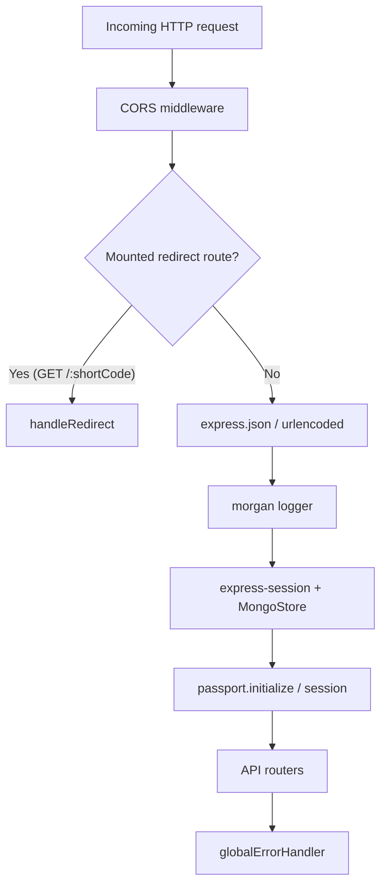
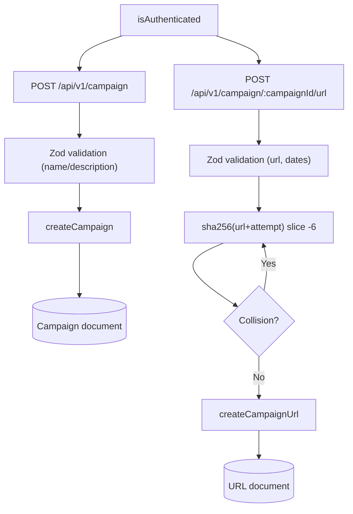
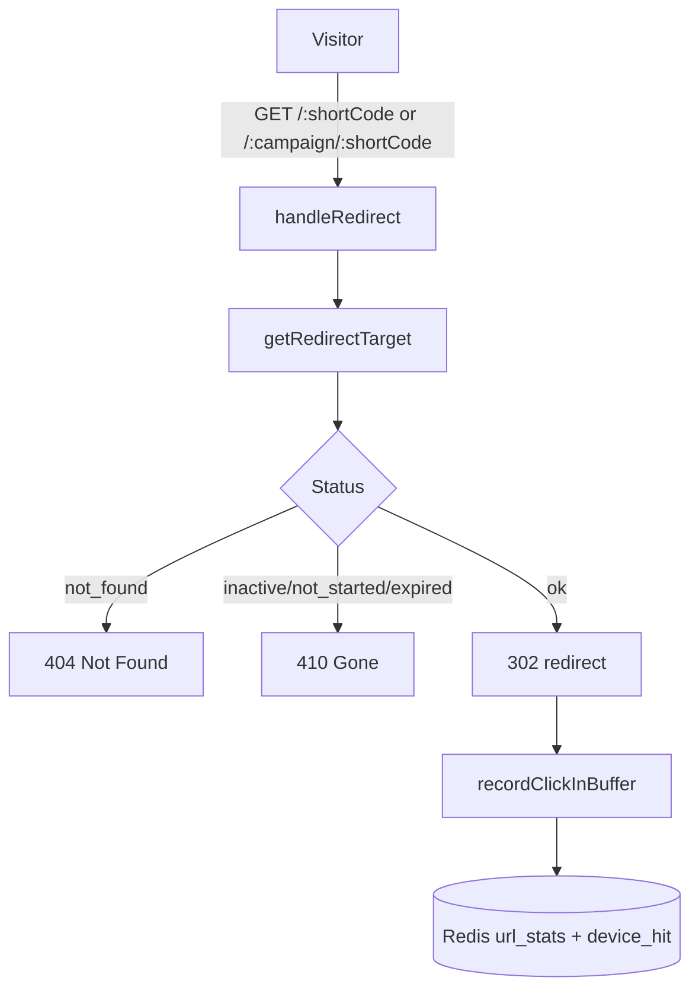
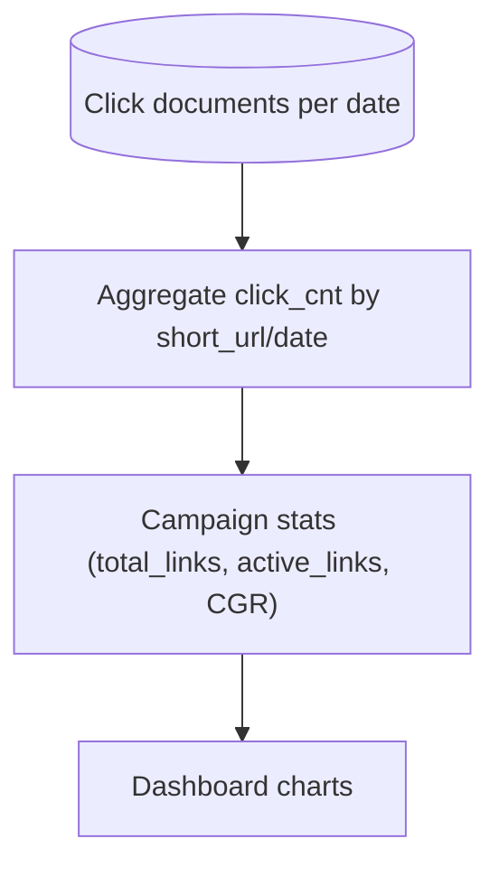
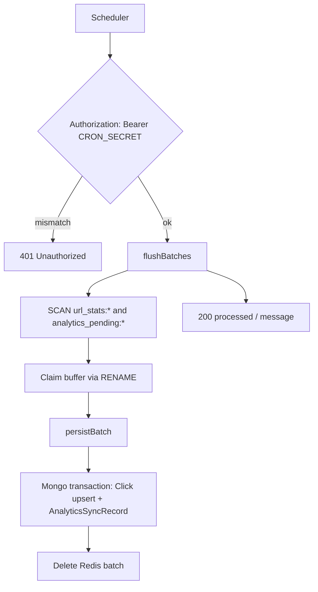
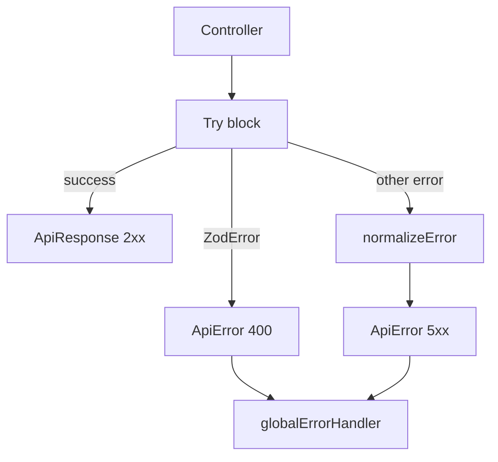

# Shortwave — Backend Workflows

This document describes the main backend request and processing workflows. Diagrams use Mermaid.

## Express Request Pipeline

## Authentication Workflows

```mermaid
flowchart TD
  subgraph OTP [Native OTP flow]
    OR[POST /api/v1/auth/otp/request] --> OU[Find or create user]
    OU --> OS["Store hashed OTP (10 min, 5 attempts)"]
    OS --> OE[Send OTP email]
    OE --> OV[POST /api/v1/auth/otp/verify]
    OV --> ODEL[Delete OTP record]
    ODEL --> OJWT[Return 7d JWT + user]
  end

  subgraph MAGIC [Web magic-link flow]
    MS[POST /api/v1/auth/signin] --> MU[Find or create user]
    MU --> MT[Sign 1h JWT]
    MT --> ME[Send sign-in email]
    ME --> MV[GET /api/v1/auth/verify?token]
    MV --> MSES[req.logIn + blockJWT + 7d JWT]
    MSES --> MREDIR[Redirect with token]
  end

  subgraph OAUTH [OAuth flow]
    OG[GET /api/v1/auth/google or /github] --> OP[passport.authenticate]
    OP --> OCB[OAuth callback]
    OCB --> OREDIR[Redirect with token]
  end
```

## Campaign & Short URL Creation Workflow

## Redirect & Click Buffering Workflow

## Analytics Aggregation Workflow

## Scheduled Analytics Sync Workflow

## Error Handling Workflow
