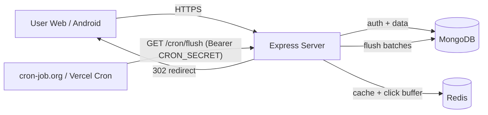
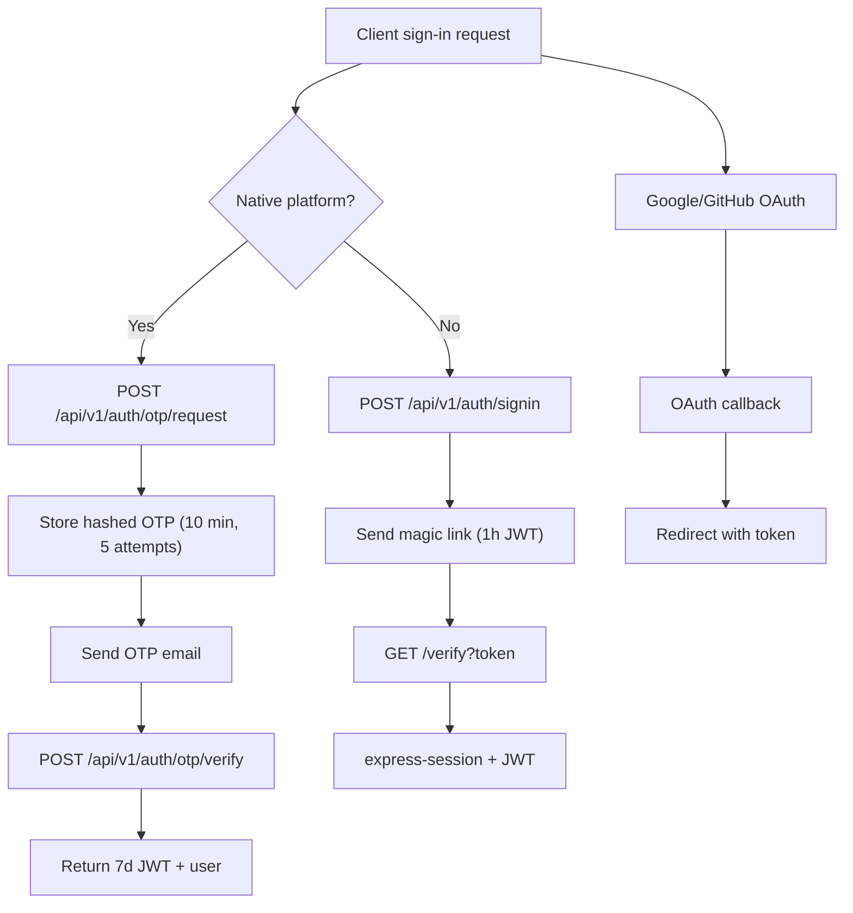
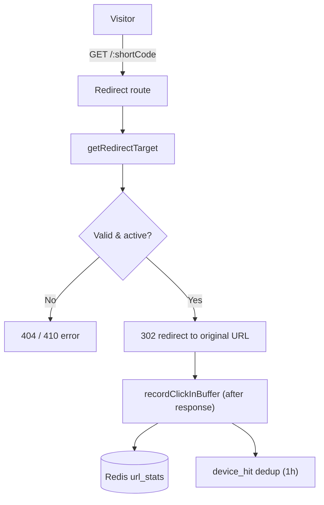
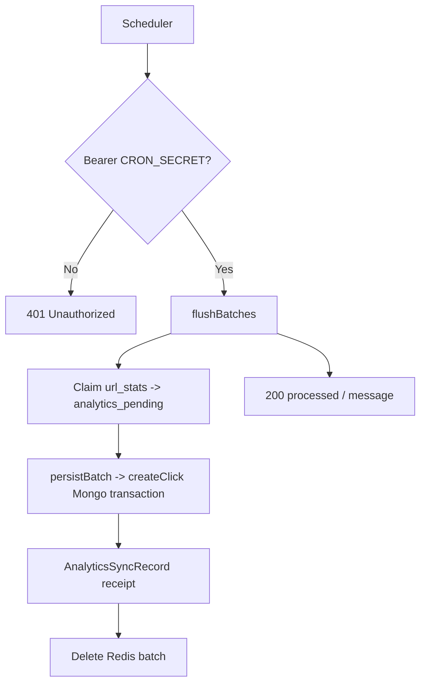

# URL Shortener — System Design

> Shortwave is a high-throughput URL shortener with per-link analytics, hybrid web/native auth, and a Redis → Mongo analytics pipeline.

## Table of Contents

- [Features](#features)
- [Scale Assumptions](#scale-assumptions)
- [Architecture](#architecture)
- [Authentication (Hybrid Session + JWT)](#authentication-hybrid-session--jwt)
- [Backend Routes](#backend-routes)
- [URL Shortening](#url-shortening)
- [Data & Caching](#data--caching)
- [Build & Run](#build--run)

---

## Features

| # | Feature | Details |
|---|---------|---------|
| 1 | **Authentication** | OAuth (Google, GitHub) + magic-link email. Hybrid: session cookies for web, JWT Bearer for native/Capacitor. |
| 2 | **URL Shortening** | 6-character Base62 slugs (e.g. `abc123`) with fast `302` redirects. |
| 3 | **Analytics** | Per-link clicks, geolocation, device/browser/OS, daily counts; responsive Recharts dashboards. |
| 4 | **Cross-Platform** | Web/desktop (Vite) + Android (Capacitor 8) from the same `dist`. |

## Scale Assumptions

- **100M DAU** → ~1B reads/day → ~10k RPS
- **5B total URLs** target
- **~1 KB/record** → 1–5 TB storage
- Optimize for **redirect latency** + **availability**

## Architecture



## Authentication (Hybrid Session + JWT)

### Web vs Native

| Platform | Mechanism | Storage | Notes |
|----------|-----------|---------|-------|
| Web | `express-session` + `connect-mongo` (cookie `connect.sid`, 7d) + JWT | httpOnly cookie + `localStorage["authToken"]` | CORS `origin: CLIENT_URL`, `credentials: true` |
| Android | JWT only (`Bearer`, 7d) | `Preferences` + `localStorage` | `withCredentials: false`, header `X-Native-Platform: capacitor` |

### Session Setup

- **Web:** `express-session` + `connect-mongo` (MongoStore, 14d TTL), `trust proxy 1`.
- **Native:** Cookies don't persist in WebView → JWT Bearer (`jsonwebtoken`, 7d, `JWT_SECRET`), sent as `Authorization: Bearer <token>`.
- **Middleware `isAuthenticated`:** tries `req.isAuthenticated()` (session); falls back to `Authorization: Bearer` → `jwt.verify` → `getUserById` → `req.user`.

### Flows

- **OTP (native):** `POST /api/v1/auth/otp/request` (email + `platform=native`) → upsert user → store hashed 6-digit code (`sha256(otp:salt)`, 10 min TTL, 5 attempts) → `sendOtpEmail` → `POST /api/v1/auth/otp/verify` validates, deletes record, returns `{ token, user }` directly. No browser hop required.
- **Magic link (web):** `POST /api/v1/auth/signin` → email 1h JWT → `GET /verify?token=` → `req.logIn` + `blockJWT` + 7d JWT → redirect with token.
- **OAuth:** `GET /google`, `GET /github` → `passport.authenticate` → callback → same redirect logic. Web only; native hides these buttons.
- **Me:** `GET /me` (protected) returns `{ user, token }` and refreshes JWT.
- **Logout:** `POST /logout` → destroy session + clear cookie **and** `blockJWT(Bearer)` for native.



## Backend Routes

| Method | Path | Description |
|--------|------|-------------|
| `POST/GET` | `/api/v1/auth/*` | Signin, OTP request/verify, verify token, me, logout, Google/GitHub OAuth + callbacks |
| `POST/GET/PATCH/DELETE` | `/api/v1/campaign`, `/api/v1/url`, `/api/v1/user` | Campaigns, short URLs, user profile |
| `GET` | `/cron/flush` | Scheduled analytics sync (Bearer `CRON_SECRET`) |
| `GET` | `/:shorturl` or `/:campaign/:shorturl` | `302` redirect to original URL |

> Uses `302` (not `301`) so browsers don't cache and every hit reaches the backend for analytics.

## URL Shortening

- **Base62** (`[0-9A-Za-z]` = 62 chars), 6 chars → 62⁶ ≈ 52B URLs.
- **Generation:** random/hash (nanoid / MD5 or SHA-256 slice) + collision retry.
- **Index** `short_url` for ~10k RPS; scale vertically + Redis cache. Read replicas/sharding only if needed.

## Data & Caching

- **MongoDB (NoSQL)** for speed; index `short_url`; front with **Redis** for higher throughput.
- Analytics are **not** written synchronously per redirect (would hurt read path). Counters buffer in Redis; cron `flushRedishStatsToMongo` bulk-writes to Mongo every minute.
- **Per-date analytics:** avoid unbounded `click_logs` subdocuments. Use separate `click` docs per `{date, country, device, browser, os, click_cnt}`, aggregated in Redis, then flushed.

```json
click_logs: [{ "date": "2026-09-07", "count": 42 }]
```

### Redirect & Analytics Buffer Flow



### Scheduled Analytics Sync Flow



## Build & Run

### Prerequisites

Node 20+, pnpm 11.5.1, Docker, Android Studio (SDK 34, JDK 17, `ANDROID_HOME`), and env files.

```bash
pnpm install
cp apps/server/.env.example apps/server/.env
cp apps/client/.env.example apps/client/.env
# edit JWT_SECRET, SESSION_SECRET, GOOGLE_*/GITHUB_*, EMAIL, CLIENT_URL, SERVER_URL, MONGODB_*, REDIS_URL, VITE_SERVER_URL, CRON_SECRET
docker-compose up -d  # Mongo + Redis
```

### Web / Desktop

```bash
pnpm run dev              # client http://localhost:5173 + server http://localhost:8080
pnpm --filter client run build && pnpm --filter server run build
```

### Android (Capacitor)

```bash
pnpm --filter client run build        # Vite dist
pnpm --filter client exec cap sync android  # -> android/app/src/main/assets/public
pnpm --filter client run cap:android  # opens Android Studio
# release
cd apps/client/android && ./gradlew assembleDebug   # APK
./gradlew bundleRelease                             # AAB
```

- **Config:** `apps/client/capacitor.config.ts` — `appId com.shortwave.app`, `webDir dist`, `server.androidScheme https`, `allowMixedContent true`, `CapacitorHttp enabled`.
- **Icon/splash:** `public/shortwave_logo.png` (640×640) → `mipmap-*/ic_launcher*.png` + `drawable*/splash.png`.
- **Native entry:** `/` → `Capacitor.isNativePlatform()` → `/signin` (JWT flow); web → `/home`. OAuth native uses `@capacitor/browser` + `App.appUrlOpen` deep-link.
- **CORS:** allows `capacitor://localhost`, `http://localhost`, `CLIENT_URL`.